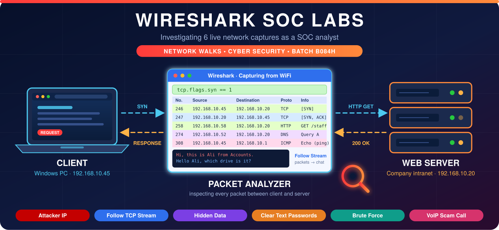
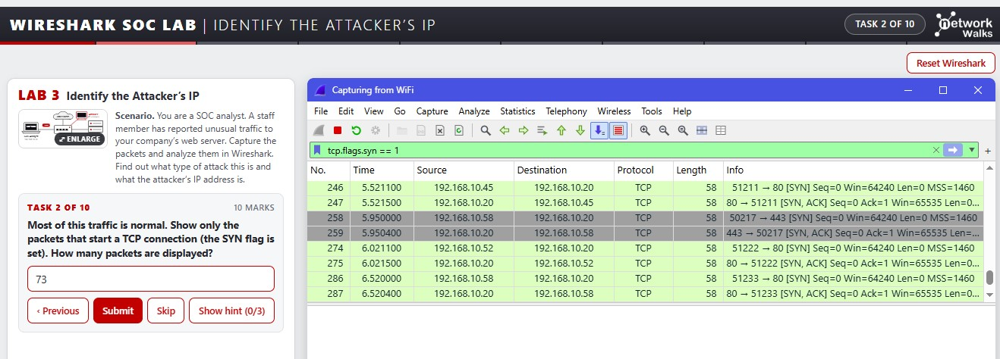
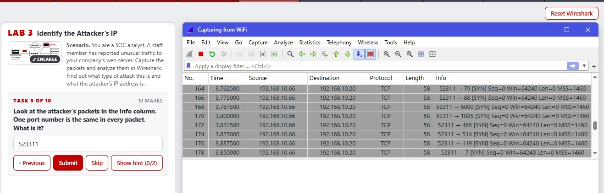
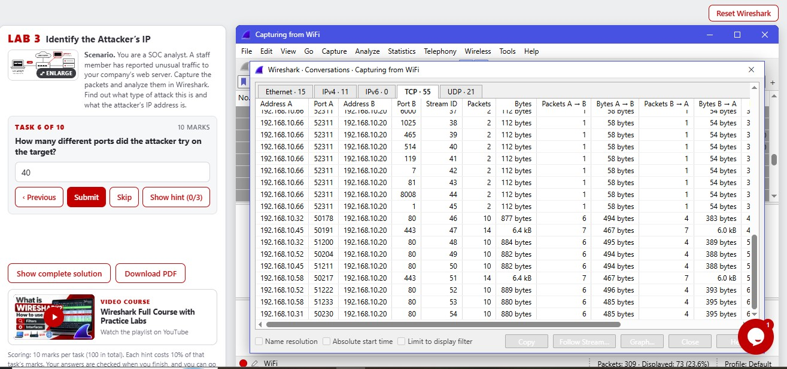
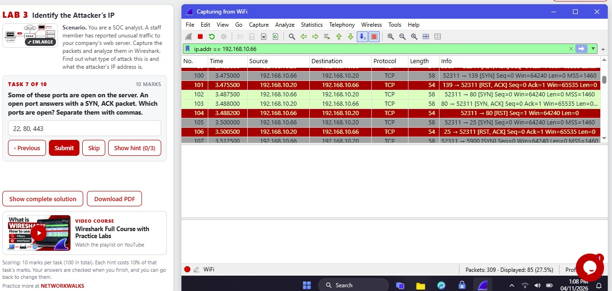
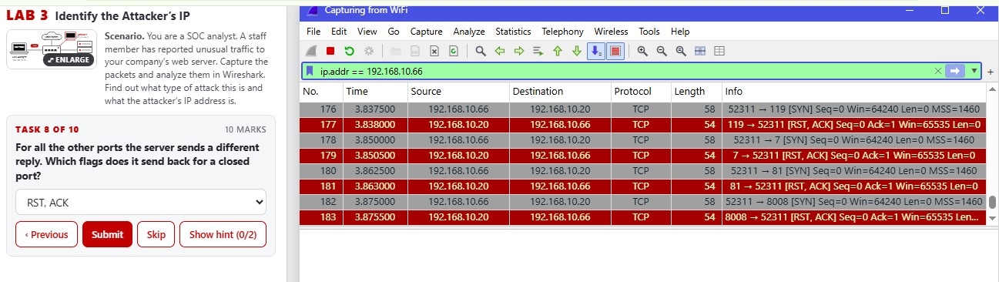

  

<h1 align="center">🔴 Lab 1: Identify the Attacker's IP</h1>

  <a href="./README.md">⬅️ Back to README</a> | <a href="./Lab2-Follow-TCP-Stream-1.md">Next: Lab 2 ➡️</a>

| Field | Details |
|:------|:--------|
| 🛠️ **Tool** | Wireshark |
| 🎓 **Batch** | B084H |
| 🎯 **Skill Practiced** | Port scan detection, SYN / SYN-ACK / RST analysis |

## 🎯 Objective
To analyze a network capture to identify an attacker performing a port scan against a web server, determine the attacker and target IPs, and analyze the TCP flags.

---

## 📝 Tasks, Solutions and Evidence

| # | Task | Solution | Evidence |
|:-:|:-----|:---------|:--------:|
| 1 | How many packets did Wireshark capture? | **309** | |
| 2 | Show only the packets that start a TCP connection (the SYN flag is set). How many packets are displayed? | **73** Filter: `tcp.flags.syn == 1` |  |
| 3 | What is the attacker's IP address? | **192.168.10.66** | |
| 4 | Which IP address is the target of the attacker's packets? | **192.168.10.20** | |
| 5 | Look at the attacker's packets. One port number is the same in every packet. What is it? | **52311** |  |
| 6 | How many different ports did the attacker try on the target? | **40** |  |
| 7 | Which ports are open? Separate them with commas. | **22, 80, 443** |  |
| 8 | Which flags does it send back for a closed port? | **RST, ACK** |  |
| 9 | How many ports are closed? | **37** | |
| 10 | What type of attack is this? | **Port scan** | |

---

## 🔍 Key Findings
- **Attacker IP:** `192.168.10.66`
- **Target IP:** `192.168.10.20`
- **Open Ports:** `22` (SSH), `80` (HTTP), `443` (HTTPS)
- **Closed Ports:** `37` ports returned a `RST, ACK` response.
- **Attack Vector:** The attacker used a single source port (`52311`) to probe multiple destination ports in a short time.

## 🛠️ Tools & Filters Used
- **Display Filters:** `tcp.flags.syn == 1`, `ip.addr == 192.168.10.66`
- **Statistics:** `Statistics -> Conversations (TCP tab)` to count the ports probed.
- **Wireshark UI:** Status bar (Packets / Displayed) to count connections.
