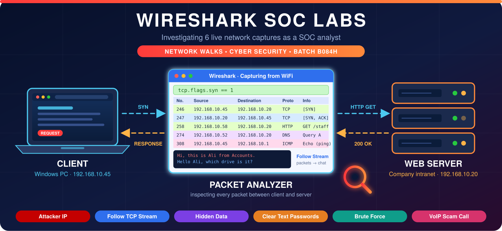
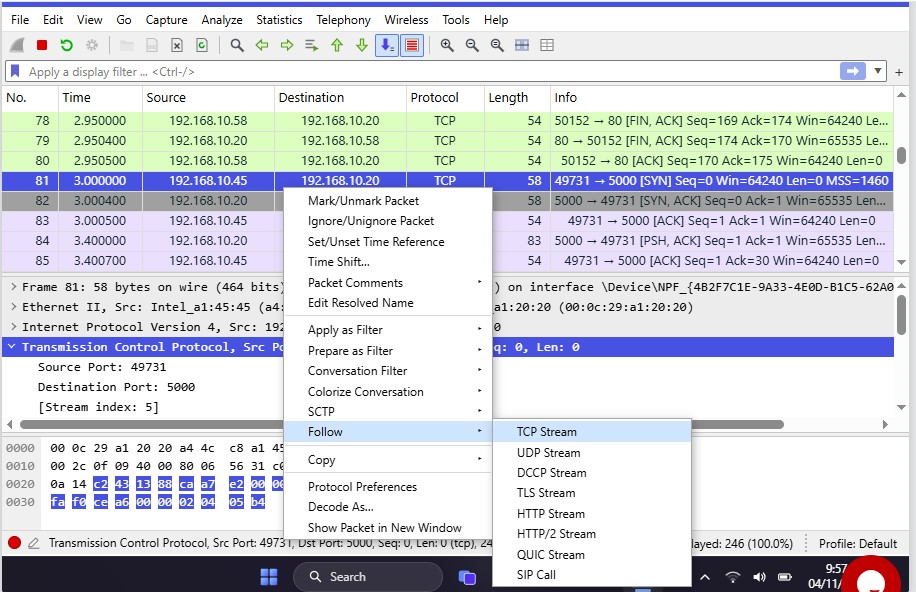
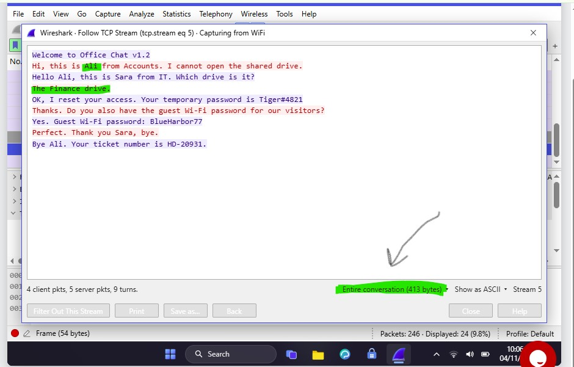
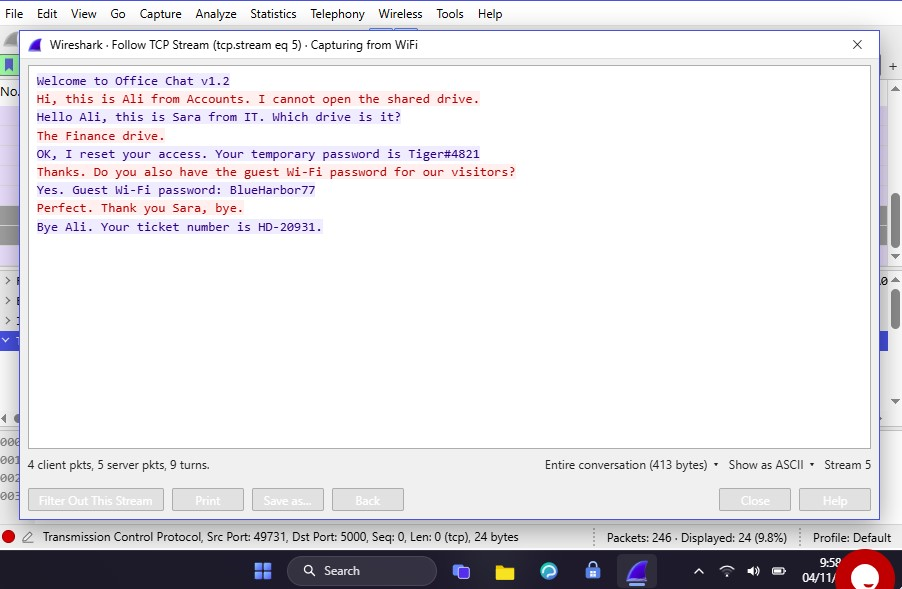

  

<h1 align="center">🔵 Lab 2: Follow TCP Stream 1</h1>

  <a href="./Lab1-Attacker-IP.md">⬅️ Back to Lab 1</a> | <a href="./Lab3-Follow-TCP-Stream-2.md">Next: Lab 3 ➡️</a>

| Field | Details |
|:------|:--------|
| 🛠️ **Tool** | Wireshark |
| 🎓 **Batch** | B084H |
| 🎯 **Skill Practiced** | Reading a plain text chat, TCP Stream analysis |

## 🎯 Objective
To investigate a plain text office chat over TCP, identify the users involved, extract leaked credentials, and understand the risks of unencrypted communication.

---

## 📝 Tasks, Solutions and Evidence

| # | Task | Solution | Evidence |
|:-:|:-----|:---------|:--------:|
| 1 | How many packets did Wireshark capture? | **246** | |
| 2 | Which port is used by the plain text office chat tool? | **5000** | |
| 3 | Which IP address started the chat? (The computer that sends the first SYN packet) | **192.168.10.45** | |
| 4 | What is the stream number of the chat? (Using Follow > TCP Stream) | **5** |  |
| 5 | How many bytes does the entire conversation have? | **413** |  |
| 6 | What is the first name of the staff member who asks for help? | **Ali** |  |
| 7 | Which shared drive could the staff member not open? | **Finance** |  |
| 8 | What is the temporary password given by IT? | **Tiger#4821** |  |
| 9 | What is the guest Wi-Fi password? | **BlueHarbor77** |  |
| 10 | What colour is the text sent by the computer that started the chat? | **Red** | |

---

## 🔍 Key Findings
- **Client IP:** `192.168.10.45` (Ali from Accounts)
- **Server IP:** `192.168.10.20` (IT / Office Chat Server)
- **Chat Port:** `5000` (Stream 5)
- **Leaked Data:** Temporary password (`Tiger#4821`) and Guest Wi-Fi password (`BlueHarbor77`).
- **Lesson:** Chat tools must use encryption (TLS/HTTPS) because plain text protocols expose sensitive data to anyone sniffing the network.

## 🛠️ Tools & Filters Used
- **Display Filter:** `tcp.port == 5000`
- **Statistics:** `Statistics -> Conversations (TCP tab)`
- **Wireshark UI:** `Follow -> TCP Stream`
