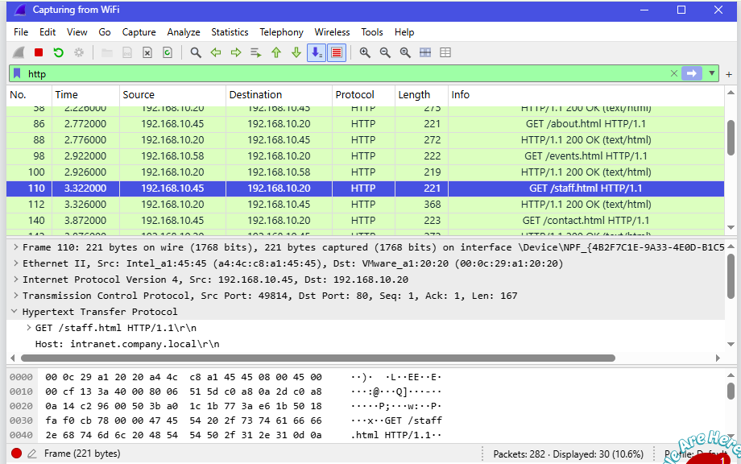
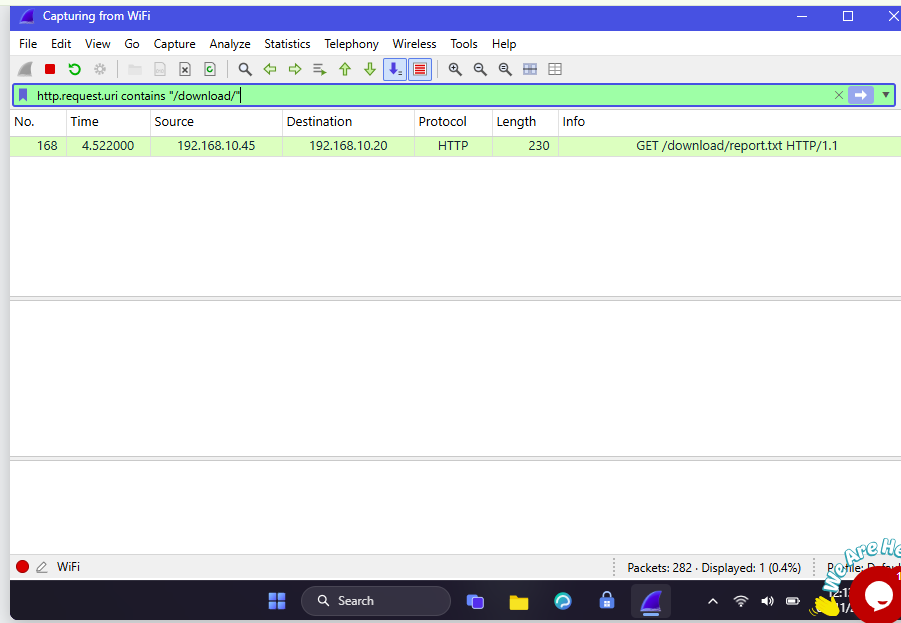
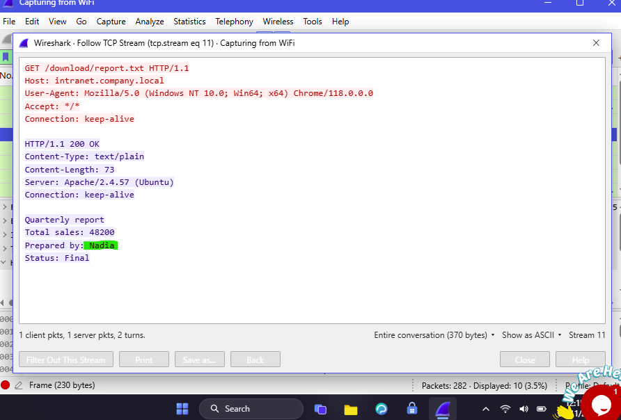

<h1 align="center">🟣 Lab 3: Follow TCP Stream, Part 2</h1>

  <a href="./Lab2-Follow-TCP-Stream-1.md">⬅️ Back to Lab 2</a> | <a href="./Lab4-HTTP-Plain-Text-Credentials.md">Next: Lab 4 ➡️</a>

| Field | Details |
|:------|:--------|
| 🛠️ **Tool** | Wireshark |
| 🎓 **Batch** | B084H |
| 🎯 **Skill Practiced** | Hidden data discovery, HTML comments, HTTP stream analysis |

## 🎯 Objective
To analyze HTTP traffic to uncover hidden HTML comments, extract sensitive information from them, and investigate downloaded plain text files.

---

## 📝 Tasks, Solutions and Evidence

| # | Task | Solution | Evidence |
|:-:|:-----|:---------|:--------:|
| 1 | How many packets did Wireshark capture? | **282** | |
| 2 | Which intranet page has a hidden note inside? | **/staff.html** |  |
| 3 | Where is the hidden note located? | **An HTML comment** (between `<!--` and `-->`) | |
| 4 | Which TCP stream number carries the /staff.html page? | **7** | |
| 5 | What is the access code word in the hidden note? | **Falcon-9921** | |
| 6 | What is the IP address of the backup server mentioned in the note? | **192.168.10.77** | |
| 7 | In the Follow TCP Stream window, which way did the hidden note (blue text) travel? | **Server to client** | |
| 8 | What HTTP status code did the server send for the /staff.html page? | **200** (OK) | |
| 9 | What is the file name downloaded from the /download/ folder? | **report.txt** |  |
| 10 | Who prepared the downloaded report? | **Nadia** |  |

---

## 🔍 Key Findings
- **Hidden Note Page:** `/staff.html` (Stream 7)
- **Hidden Data Type:** HTML Comment (`<!-- ... -->`) sent from server to client.
- **Leaked Data:** Access code word (`Falcon-9921`) and backup server IP (`192.168.10.77`).
- **Downloaded File:** `report.txt` (Prepared by: Nadia).

## 🛠️ Tools & Filters Used
- **Display Filters:** `http`, `http.request.uri contains "download"`
- **Wireshark UI:** `Follow -> TCP Stream`
