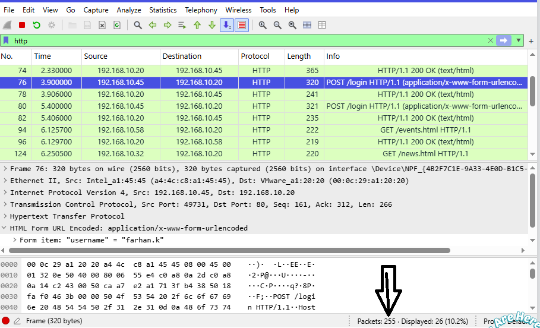
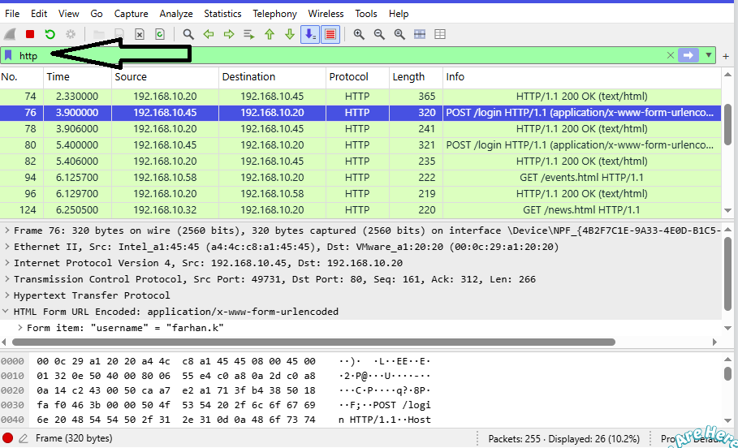
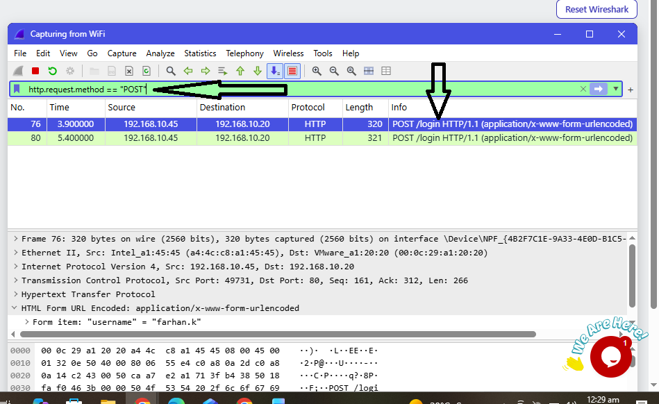
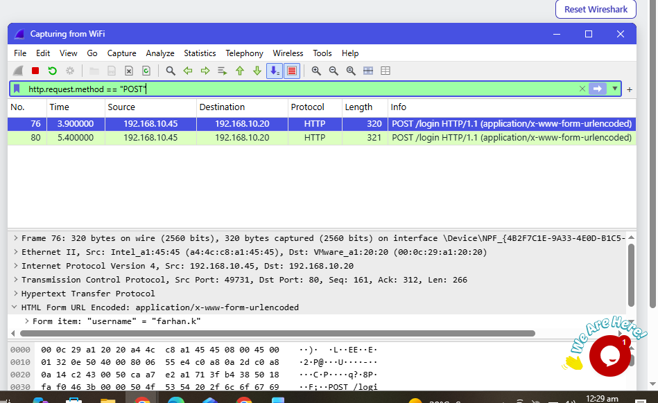
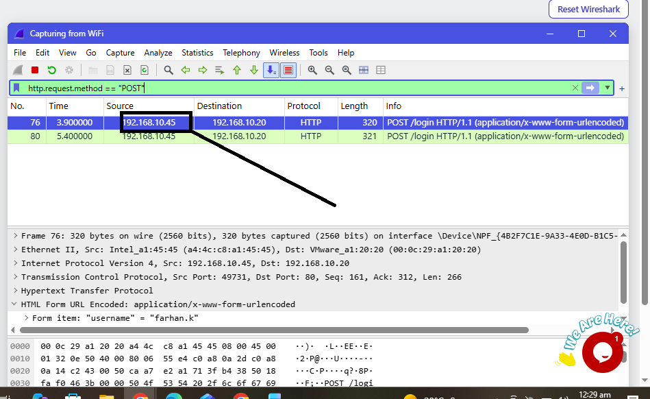
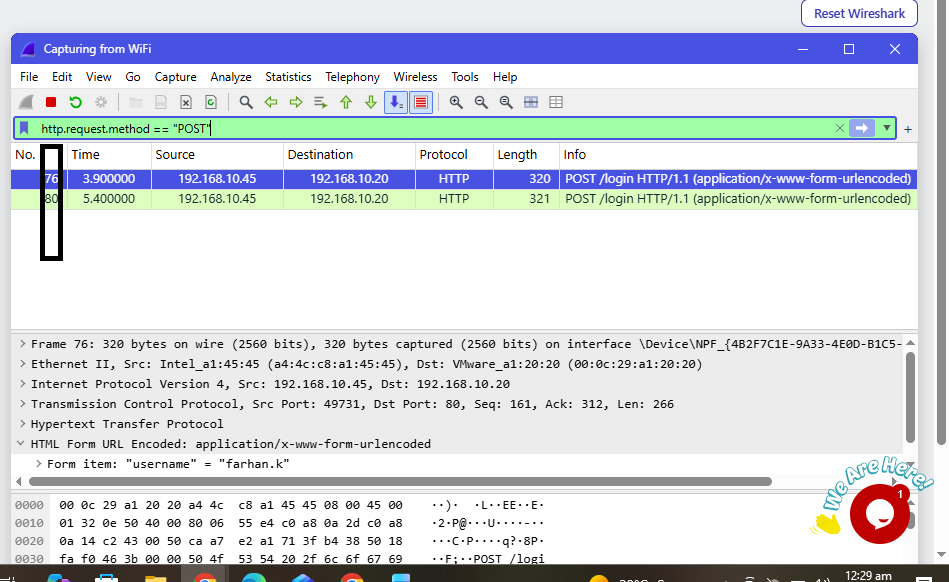

<h1 align="center">🟠 Lab 4: HTTP Plain Text Credentials</h1>

  <a href="./Lab3-Follow-TCP-Stream-2.md">⬅️ Back to Lab 3</a> | <a href="./Lab5-Brute-Force-Attacker.md">Next: Lab 5 ➡️</a>

| Field | Details |
|:------|:--------|
| 🛠️ **Tool** | Wireshark |
| 🎓 **Batch** | B084H |
| 🎯 **Skill Practiced** | HTTP packet analysis, Extracting plain text credentials |

## 🎯 Objective
To investigate an unencrypted HTTP login process, extract the submitted username and password from the packet payload, and identify the security risks of using HTTP.

---

## 📝 Tasks, Solutions and Evidence

| # | Task | Solution | Evidence |
|:-:|:-----|:---------|:--------:|
| 1 | How many packets did Wireshark capture? | **255** | |
| 2 | Which protocol carried the staff sign-in? | **HTTP** |  |
| 3 | Which HTTP method did the sign-in use? | **POST** |  |
| 4 | Which page path did the form send the sign-in to? | **/login** |  |
| 5 | Which PC sent the sign-in? | **192.168.10.45** |  |
| 6 | How many times did the user send the sign-in form? | **2** |  |
| 7 | What is the username submitted in the form? | **farhan.k** | |
| 8 | What password did the user type on the successful second attempt? | **Mango#2026** | |
| 9 | Which line in the packet details shows the typed username and password in an easy list? | **HTML Form URL Encoded** | |
| 10 | How can the company stop people from reading passwords like this? | **Use HTTPS** | |

---

## 🔍 Key Findings

> **Investigation Summary:**
> - **Protocol Analyzed:** HTTP (Unencrypted)
> - **Request Method:** `POST /login`
> - **Target PC:** `192.168.10.45`
> - **User Identity:** `farhan.k`
> - **Login Attempts:** 2 (First attempt failed, Second attempt succeeded)
> - **Exposed Password:** `Mango#2026`
> - **Root Cause:** Passwords sent over HTTP are in plain text, making them highly vulnerable to sniffing.
> - **Remediation:** The company must enforce **HTTPS** (TLS/SSL) to encrypt all login traffic.

## 🛠️ Tools & Filters Used
- **Display Filters:** `http`, `http.request.method == "POST"`
- **Wireshark UI:** `HTML Form URL Encoded` (in Packet Details pane)
