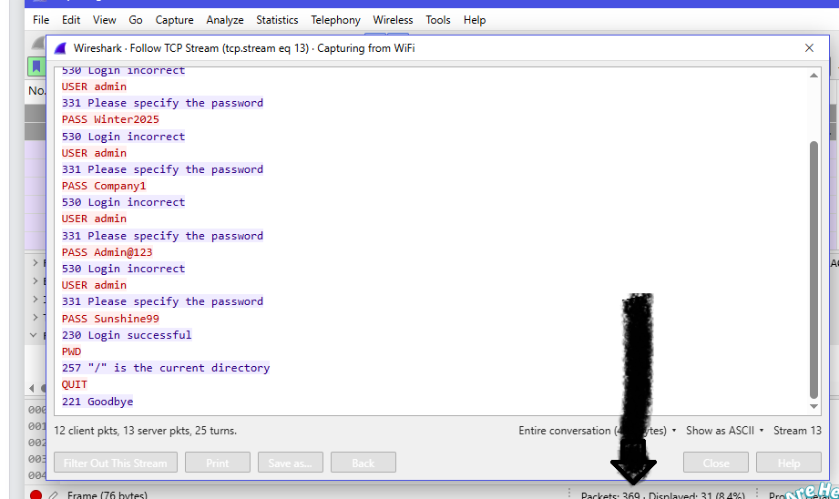
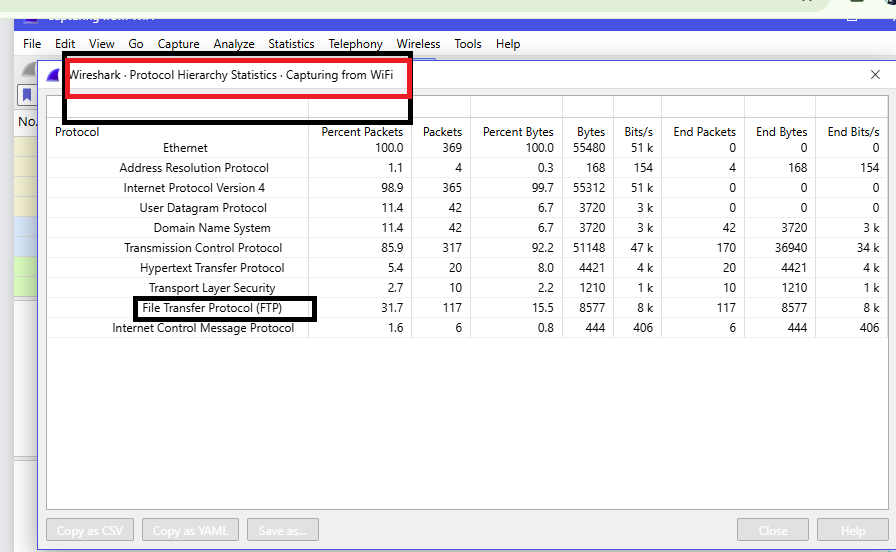
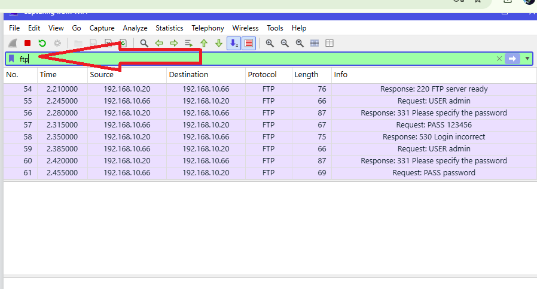
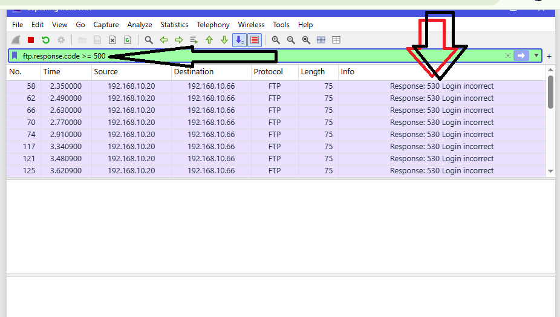
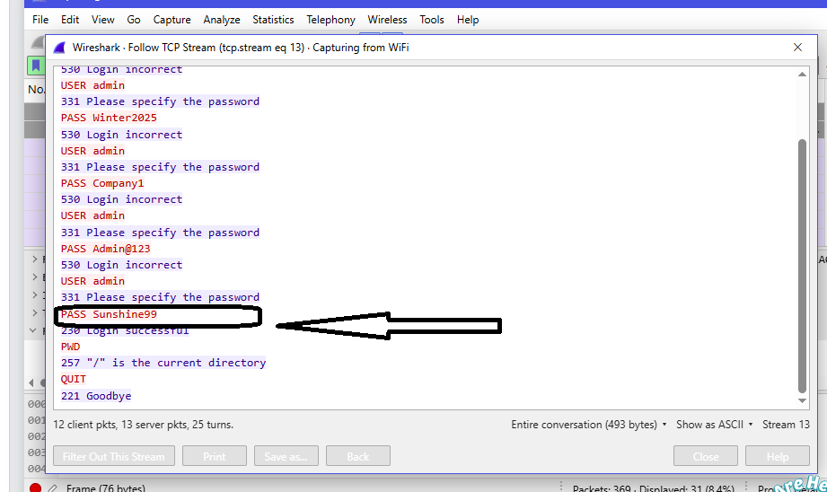

<h1 align="center">🟢 Lab 5: Catch the Brute Force Attacker</h1>

  <a href="./Lab4-HTTP-Plain-Text-Credentials.md">⬅️ Back to Lab 4</a> | <a href="./Lab6-Call-Scammer.md">Next: Lab 6 ➡️</a>

| Field | Details |
|:------|:--------|
| 🛠️ **Tool** | Wireshark |
| 🎓 **Batch** | B084H |
| 🎯 **Skill Practiced** | Brute force detection, FTP protocol analysis |

## 🎯 Objective
To analyze FTP network traffic, identify an attacker conducting a brute-force login attack against a server, determine the credentials used in the successful login, and classify the attack type.

---

## 📝 Tasks, Solutions and Evidence

| # | Task | Solution | Evidence |
|:-:|:-----|:---------|:--------:|
| 1 | How many packets did Wireshark capture? | **369** |  |
| 2 | Which protocol are the failed sign-ins on? | **FTP** |  |
| 3 | Which IP address is the FTP server that was attacked? | **192.168.10.20** |  |
| 4 | Which IP address sent all the login attempts? | **192.168.10.66** | |
| 5 | Which username did the attacker try again and again? | **admin** | |
| 6 | Which FTP reply code means "Login incorrect"? | **530** |  |
| 7 | How many failed logins did the attacker make? | **24** | |
| 8 | Which FTP reply code shows a successful login? | **230** | |
| 9 | What password did the attacker use in the successful login? | **Sunshine99** |  |
| 10 | What type of attack is this? | **Brute force** | |

---

## 🔍 Key Findings

| Investigation Aspect | Details |
|:---|:---|
| **Attacker IP** | `192.168.10.66` |
| **Target IP** | `192.168.10.20` (FTP Server) |
| **Failed Logins** | 24 attempts (Code `530`) |
| **Successful Credentials** | Username: `admin` / Password: `Sunshine99` |
| **Success Code** | `230` (Login successful) |
| **Attack Type** | **Brute Force Attack** (Multiple password guesses until one succeeds) |

## 🛠️ Tools & Filters Used
- **Display Filters:** `ftp`, `ftp.request.command == "PASS"`, `ftp.request.command == "USER"`, `ftp.response.code >= 500`, `ftp.response.code == 530`, `ftp.response.code == 230`
- **Statistics:** `Statistics -> Protocol Hierarchy`
- **Wireshark UI:** `Follow -> TCP Stream`
