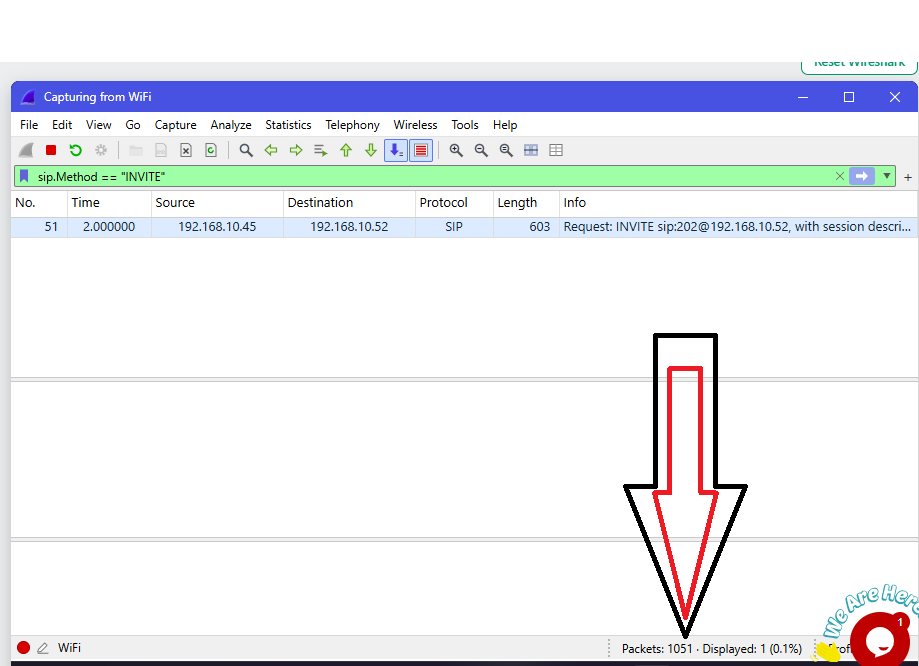
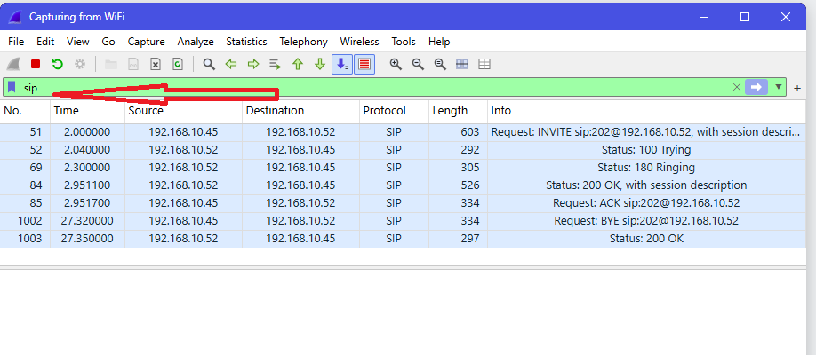
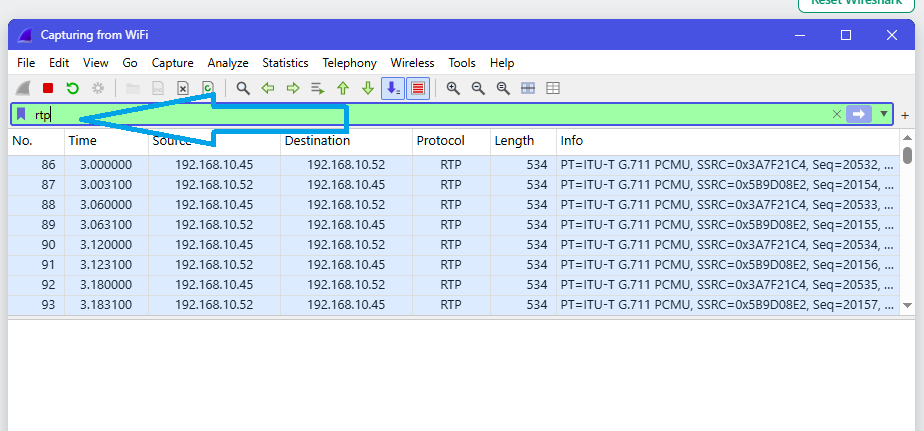
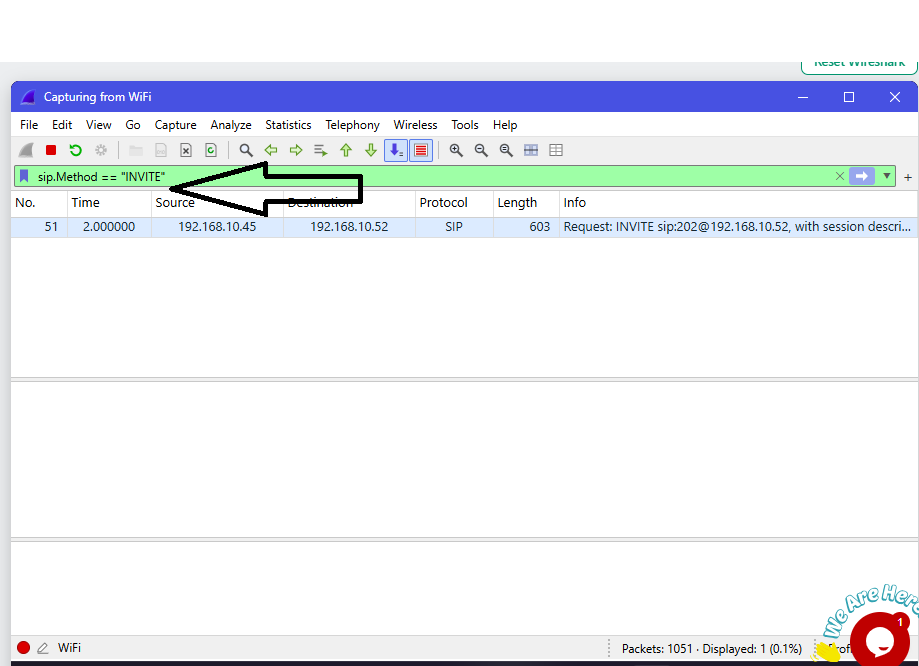

<h1 align="center">🩷 Lab 6: Catch the Call Scammer</h1>

  <a href="./Lab5-Brute-Force-Attacker.md">⬅️ Back to Lab 5</a> | <a href="./README.md">Back to README ➡️</a>

| Field | Details |
|:------|:--------|
| 🛠️ **Tool** | Wireshark |
| 🎓 **Batch** | B084H |
| 🎯 **Skill Practiced** | VoIP / SIP call analysis, extracting voice data |

## 🎯 Objective
To investigate an unencrypted VoIP (Voice over IP) phone call, identify the caller and receiver, analyze the SIP and RTP protocols, and extract sensitive financial information spoken during the call.

---

## 📝 Tasks, Solutions and Evidence

| # | Task | Solution | Evidence |
|:-:|:-----|:---------|:--------:|
| 1 | How many packets did Wireshark capture? | **1051** |  |
| 2 | Which protocol set up the call (INVITE, Ringing, OK)? | **SIP** |  |
| 3 | Which protocol carried the voice itself? | **RTP** |  |
| 4 | Which extension number made the call? | **101** |  |
| 5 | What is the name of the caller? | **Ali Raza** | |
| 6 | Which codec carried the voice? (Check RTP payload type) | **PCMU** | |
| 7 | Who answered the call? (Listen to the audio) | **Sara** | |
| 8 | What are the last 4 digits of the card number read out? | **2394** | |
| 9 | What expiry date did the caller say? | **09/28** | |
| 10 | How can the company stop people from listening to calls like this? | **Encrypt the call (SRTP)** | |

---

## 🔍 Key Findings

| Investigation Aspect | Details |
|:---|:---|
| **Call Setup Protocol** | SIP (UDP port 5060) |
| **Voice Protocol** | RTP (G.711 PCMU Codec) |
| **Caller Details** | Ali Raza (Extension 101) |
| **Receiver Details** | Sara (Payments desk) |
| **Leaked Data** | Credit Card ending in `2394`, Expiry: `09/28` |
| **Remediation** | Use **SRTP** (Secure Real-time Transport Protocol) and TLS to encrypt voice and signaling traffic. |

## 🛠️ Tools & Filters Used
- **Display Filters:** `sip`, `rtp`, `sip.Method == "INVITE"`
- **Wireshark UI:** `Telephony -> VoIP Calls` (to play the audio)
