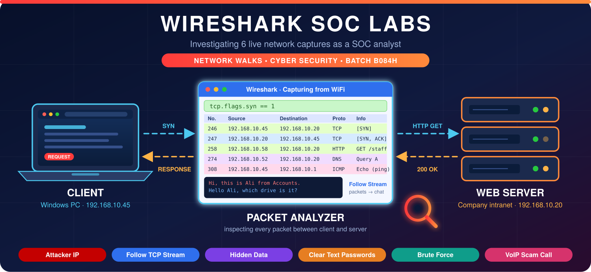

  
 <h1 align="center">🦈 Wireshark SOC Labs: Network Traffic Investigation</h1> 
 <b>Investigating 6 live network captures as a SOC analyst: attackers, hidden data, clear text passwords, brute force and a scam call</b> 
 
      

# 🛡️ Wireshark SOC Labs: Week 1

## 🕵️ Intern Details

| Field | Details |
|:------|:--------|
| 👨‍💻 **Name** | Muhammad Ayaz |
| 🐙 **GitHub** | [ayazarshad64-ops](https://github.com/ayazarshad64-ops) |
| 🏢 **Internship** | Network Walks, Cyber Security Program |
| 🎓 **Batch** | B084H |
| 🧑‍🏫 **Instructor** | Mr. Waqas Karim |
| 🛠️ **Tool Used** | Wireshark (browser-based SOC labs) |

## 🎯 Project Objective

To investigate six network captures using Wireshark, acting as a SOC analyst. In each lab I used display filters, Follow TCP Stream and Statistics tools to answer 10 tasks, find the attacker or the leaked data, and document how I found it.

## 🧪 Labs at a Glance

| Lab | Title | Skill Practiced | Write-up |
|:---:|:------|:----------------|:--------:|
|  | 🔴 **Identify the Attacker's IP** | Port scan detection, SYN / SYN-ACK / RST analysis | [Open](./Lab1-Attacker-IP.md) |
|  | 🔵 **Follow TCP Stream 1** | Reading a plain text chat | [Open](./Lab2-Follow-TCP-Stream-1.md) |
|  | 🟣 **Follow TCP Stream, Part 2** | Hidden data in an HTML comment | [Open](./Lab3-Follow-TCP-Stream-2.md) |
|  | 🟠 **HTTP Plain Text Credentials** | Clear text passwords over HTTP | [Open](./Lab4-HTTP-Plain-Text-Credentials.md) |
|  | 🟢 **Catch the Brute Force Attacker** | Brute force login detection | [Open](./Lab5-Brute-Force-Attacker.md) |
|  | 🩷 **Catch the Call Scammer** | VoIP / SIP call analysis | [Open](./Lab6-Call-Scammer.md) |

## 🛠️ Wireshark Skills Used

| Skill | Examples / Usage |
|:------|:-----------------|
| 🔍 **Display filters** | `ip.addr`, `tcp.port`, `tcp.flags.syn`, `http`, `http contains` |
| 💬 **Follow Stream** | TCP Stream / HTTP Stream |
| 📊 **Statistics** | Conversations and Endpoints |
| 🚩 **TCP flags** | SYN, SYN-ACK, RST, ACK |
| ☎️ **Telephony** | VoIP Calls |

